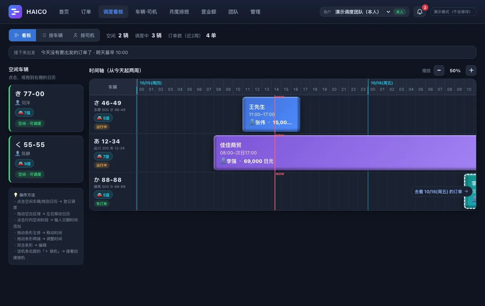

# HAICO派车

**不再对着 Excel 排车。拖一下，就派好车。**

面向在日本经营出租车・专车・接送的个体经营者和小规模经营者 
车辆、司机、预约一屏掌握，时间冲突自动拦截

 

调度看板 — 左边是空闲车辆，拖到右边的时间轴上就完成派车

 

## ✨ 调度所需，一应俱全

| | 功能 | 说明 |
|:-:|---|---|
| 🖱️ | **拖放即派车** | 把空车拖到日历上即可完成派车。拖动色条即可微调时间，跨夜、跨天也能直接安排 |
| 🚗 | **车辆与司机名册** | 车牌・座位数・负责人集中管理。车检・保险到期提醒与行驶里程记录（Pro） |
| 📅 | **按车・按人的月度排班** | “这辆车什么时候出勤？”“这个人什么时候上班？”一目了然 |
| 📊 | **营业额报表** | 从预约自动汇总，按种类・客户・司机・车辆分类。日元・人民币等按币种分别统计 |
| 🔗 | **外部共享链接** | 给司机看行程和航班号，给客户只看所选的预约。必须设定有效期，金额自动隐藏（Pro） |
| 🔐 | **精细的权限控制** | 按成员分别开启“调度编辑、金额查看、车辆管理”，每个人只看到该看的信息（Pro） |
| 📱 | **手机也能用** | 外出时也能用手机查看当天的预约和空车 |

## 🚀 三步开始

1. 打开 **[haico.mono-apps.com](https://haico.mono-apps.com/)**，免费注册
2. 登记车辆和司机
3. 把空车拖到日历上 —— 第一次派车就完成了（注册后有使用指引）

## 🔗 相关链接

- 🌐 官网：[HAICO派车](https://haico.mono-apps.com/)
- 📖 [Excel 调度表到极限了？免费改用拖放式派车](https://haico.mono-apps.com/guide)
- 🚕 [出租车・接送的派车调度](https://haico.mono-apps.com/taxi-dispatch)
- ℹ️ [关于 HAICO](https://haico.mono-apps.com/about)

 
HAICO派车 · 适用于出租车・接送・包车・租车・公务车

